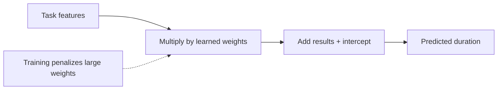
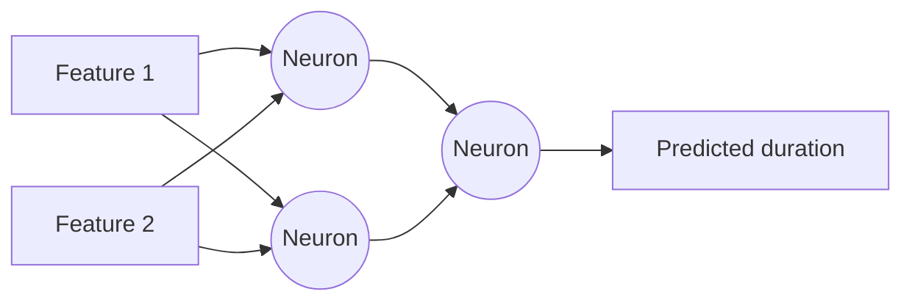
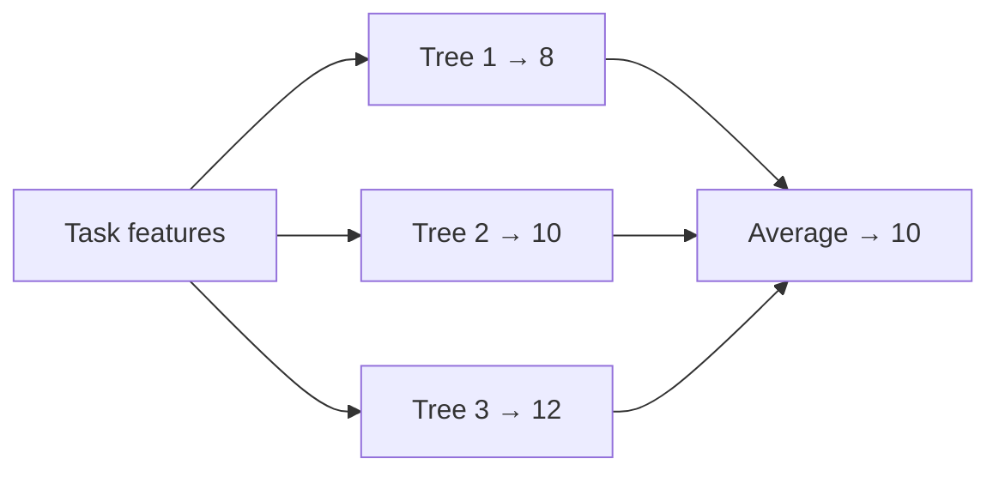
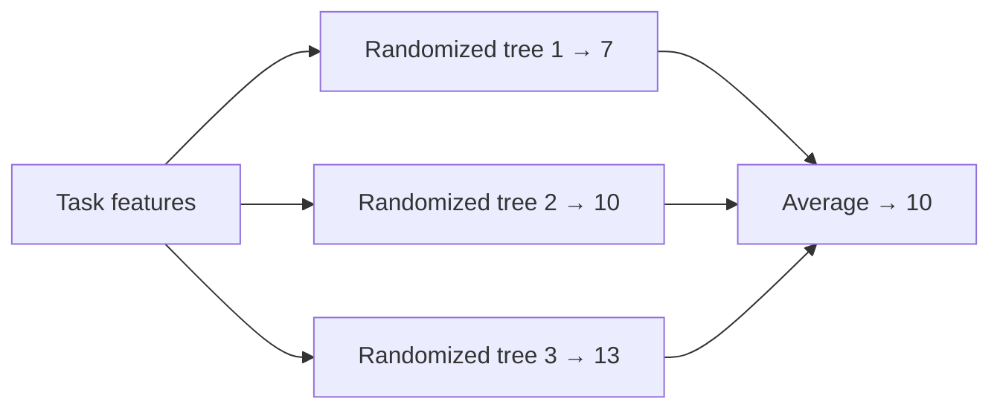

# NGA-OVIS

`NexGen Analytics` work for Sandia `Open-source Varnish Information System`.

## Apps

Entry point for an app is `apps/[name]/src/[name]/cli.py`.

### modeling_training

- `benchmark.py`: Train models and compare results
- `dataset.py`: Loading, feature extraction, targets, splitting
- `evaluation.py`: Metrics and result data structures
- `models.py`: Dummy, Ridge, MLP, Random Forest, etc, model factories

Models:
- **Dummy:** A simple baseline that ignores the input features and always
predicts a fixed value, such as the mean target value. It helps assess whether
more complex models add value.


- **Ridge:** A linear regression model with a penalty that shrinks coefficients,
reducing overfitting and improving stability when features are correlated.



- **MLP:** A multilayer perceptron, or neural network, that learns nonlinear
relationships through layers of interconnected neurons.



- **Random forest:** An ensemble of decision trees trained on different random
samples of the data. Averaging their predictions improves robustness and
reduces overfitting.



- **Extra trees:** An ensemble similar to a random forest, but with more
randomness when choosing tree splits. This often makes training faster and
reduces prediction variance.



- **Hist GB:** Histogram-based gradient boosting builds trees sequentially, with
each tree correcting errors from the previous ones. Grouping feature values into
bins makes training efficient.


### modeling_prediction

Expected CPU and memory for this input deck under the reference configuration.

Reference configuration are:
- `nodes` == 1
- `ntasks` == 48
- `ntasks_per_node` == 48
- `omp_num_threads` == 1

## Setup

```bash
python3 -m venv .venv
source .venv/bin/activate # for Linux and Mac
.\.venv\Scripts\activate # for Windows
(.venv) pip install -r requirements.txt
```

## How to use

```bash
(.venv) modeling-training --simu {path}
# simu (simulations): path to the folder with input decks and run profiles

(.venv) modeling-prediction --model {path} --input {path} --particle-count {count}
# model: path to load model
# input: path to the input deck you want to predict
# particle-count: initial number of simulated particles
```

See the [deck vector schema](doc/deck-vector-schema.md) for
classification rules and cutoff coverage.

## How to quit

```bash
(.venv) deactivate # to exit venv
```

# Examples

```bash
(.venv) modeling-training --simu data/

(.venv) modeling-prediction --model output/models/cpu_model.joblib \
  --input data/input-decks/in.test --particle-count 256000

(.venv) modeling-prediction --model output/models/memory_model.joblib \
  --input data/input-decks/in.test --particle-count 256000
```

# Results

After training (selection summary; per-target error tables are also printed):
```txt
- Total 190 files
- Reference configuration:       nodes=1,       ntasks=48,       ntasks_per_node=48       and omp_num_threads=1
- Load 117 simulations

---------------- RESOURCE: cpu ----------------
MODEL          TARGET               MAE          RMSE  MAE VS DUMMY    RMSE VS DUMMY
dummy          max               0.1042        0.1655          0.0%          0.0%
dummy          mean              1.8085        2.3681          0.0%          0.0%
dummy          min              11.4478       13.6752          0.0%          0.0%
ridge          max               0.1124        0.1654         -7.9%          0.0%
ridge          mean              1.9798        2.4956         -9.5%         -5.4%
ridge          min              11.2496       13.5208          1.7%          1.1%
mlp            max               0.0926        0.1568         11.1%          5.2%
mlp            mean              1.8442        3.1369         -2.0%        -32.5%
mlp            min              12.5802       15.4968         -9.9%        -13.3%
random_forest  max               0.0755        0.1301         27.5%         21.4%
random_forest  mean              1.6333        2.8115          9.7%        -18.7%
random_forest  min              12.0874       15.4488         -5.6%        -13.0%
extra_trees    max               0.0817        0.1364         21.6%         17.6%
extra_trees    mean              1.6648        2.7982          7.9%        -18.2%
extra_trees    min              11.5533       14.8908         -0.9%         -8.9%
hist_gb        max               0.0777        0.1321         25.5%         20.2%
hist_gb        mean              1.7541        3.0937          3.0%        -30.6%
hist_gb        min              12.4505       16.0588         -8.8%        -17.4%

Combined validation score (all targets, MAE + RMSE; lower is better):
dummy                  1.0000
ridge                  1.0330
mlp                    1.0689
random_forest          0.9644
extra_trees            0.9681
hist_gb                1.0136
Selected model: random_forest
Held-out test evaluation: random_forest (12 simulations)
TARGET               MAE          RMSE
max               0.0790        0.1741
mean              1.7440        3.0562
min              14.2470       19.0316
Saved random_forest to output/models/cpu_model.joblib

---------------- RESOURCE: memory ----------------
MODEL          TARGET               MAE          RMSE  MAE VS DUMMY    RMSE VS DUMMY
dummy          max           14089.0844    22731.4456          0.0%          0.0%
dummy          mean           9101.5515    10995.8565          0.0%          0.0%
dummy          min            7314.4691     8482.2985          0.0%          0.0%
ridge          max           13475.0372    22619.7437          4.4%          0.5%
ridge          mean           8752.8844    11091.7623          3.8%         -0.9%
ridge          min            7139.9493     8382.7805          2.4%          1.2%
mlp            max           12522.0123    21605.0552         11.1%          5.0%
mlp            mean           8053.5566    10273.6957         11.5%          6.6%
mlp            min            8687.3360    10151.6534        -18.8%        -19.7%
random_forest  max           11794.1934    19927.1968         16.3%         12.3%
random_forest  mean           7881.5613     9329.6594         13.4%         15.2%
random_forest  min            9690.6939    10848.2312        -32.5%        -27.9%
extra_trees    max           11581.8887    20554.6640         17.8%          9.6%
extra_trees    mean           7360.7467     9009.5850         19.1%         18.1%
extra_trees    min            8292.1306     9409.0039        -13.4%        -10.9%
hist_gb        max           11968.2803    20161.7959         15.1%         11.3%
hist_gb        mean           8183.8112     9541.6061         10.1%         13.2%
hist_gb        min           10285.2144    11950.1282        -40.6%        -40.9%

Combined validation score (all targets, MAE + RMSE; lower is better):
dummy                  1.0000
ridge                  0.9811
mlp                    1.0071
random_forest          1.0053
extra_trees            0.9329
hist_gb                1.0531
Selected model: extra_trees
Held-out test evaluation: extra_trees (12 simulations)
TARGET               MAE          RMSE
max           18289.3304    27169.1706
mean          11145.8525    14515.7275
min           13117.7251    15271.8091
Saved extra_trees to output/models/memory_model.joblib
```

After prediction:
```txt
Model: output/models/cpu_model.joblib
{'max': 4.316, 'mean': 4.035, 'min': 4.000}
```
