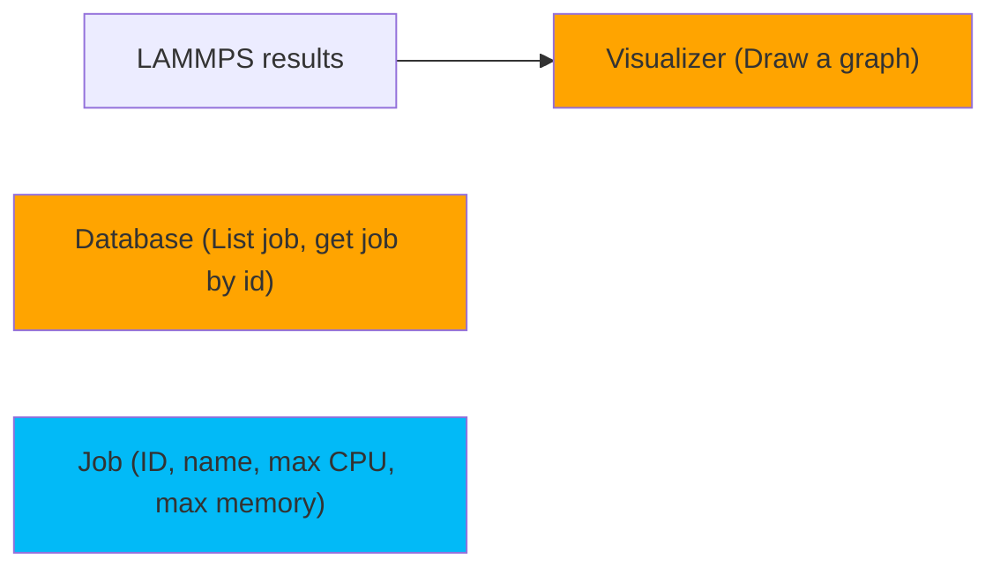
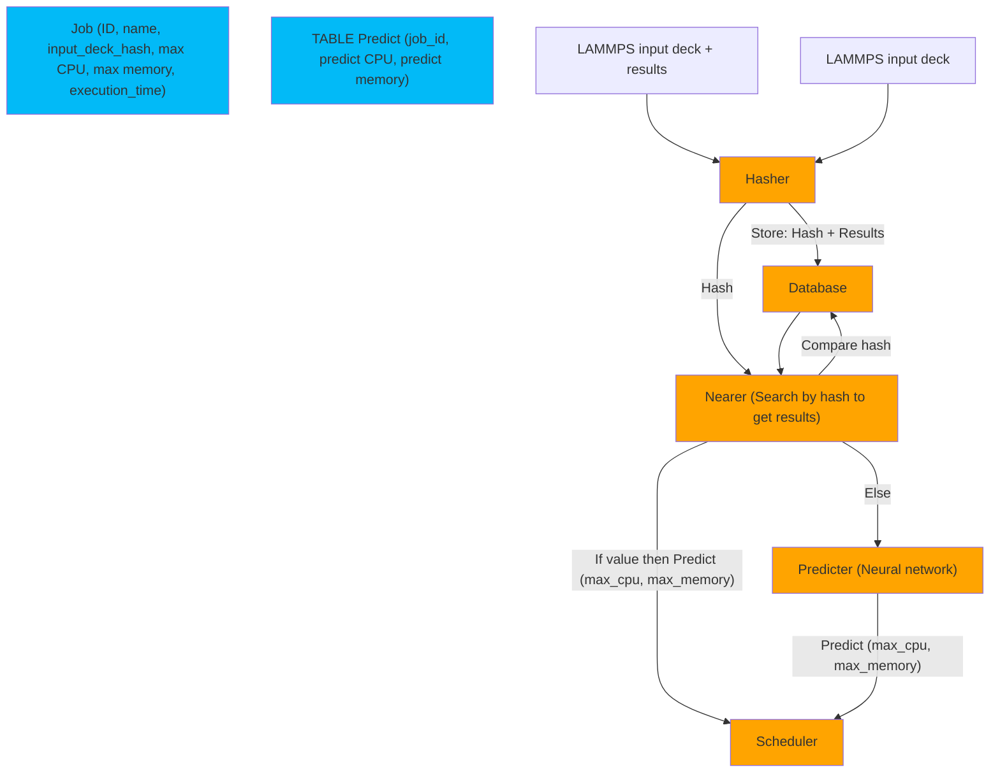

# NGA-OVIS

`NexGen Analytics` work for Sandia `Open-source Varnish Information System`.

## Datas

- Create `/data/lammps_input_decks/`
- Create `/data/lammps_results/`
- Unzip `ldms_data.zip`
- In *input_decks* folder:
  - Put the `in.[problem]` files
- In *results* folder:
  - Put the `summary.csv` file and
  - Put the folders `[problem]/[job_id]/ldms_metrics.csv`

Example:
```
data/
-| lammps_input_decks/
----| in.A
----| in.B
-| lammps_results/
----| summary.csv
# job_id, build, problem
# 101, cpu_mpi_omp, A
# 102, cpu_mpi_omp, B
----| A/101/ldms_metrics.csv
----| B/102/ldms_metrics.csv
```

## Commands

### Setup and end working session

```bash
python3 -m venv .venv
source .venv/bin/activate # for Linux and Mac
.\.venv\Scripts\activate # for Windows
(.venv) pip install -r requirements.txt

# ... work here (see Work session) ...

(.venv) deactivate
```

### Work session

```bash
(.venv) database --list
# No jobs found.
# or
# [for each jobs] { Job( ... ) }

(.venv) database --getid [X]
# Job not found.
# or
# Job( ... )

(.venv) hasher # WIP

(.venv) predicter --train data/

(.venv) visualizer --file [problem]/[job_id]/ldms_metrics.csv
# Display graph.
```

## Architecture

- Apps are in orange.
- The database tables are blue.




## Goal :

