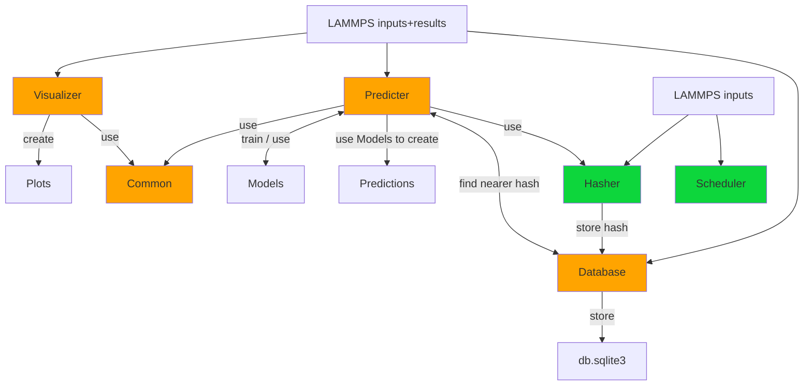

# NGA-OVIS

`NexGen Analytics` work for Sandia `Open-source Varnish Information System`.

## Commands

### Setup and end working session

```bash
python3 -m venv .venv
source .venv/bin/activate # for Linux and Mac
.\.venv\Scripts\activate # for Windows
(.venv) pip install -r requirements.txt

# ... work here (see Work session) ...

(.venv) deactivate
```

### Setup data

See [this README](./data/README.md).

### Work session

```bash
(.venv) database --list
# No jobs found.
# or
# [for each jobs] { Job( ... ) }

(.venv) database --getid [X]
# Job not found.
# or
# Job( ... )

(.venv) hasher # WIP

(.venv) predicter --train data/
# Training neural network, save best model, display graphs.

(.venv) predicter --predict [path]
# Use best model to make a prediction.
# predicter --predict data/lammps_input_decks/in.binary_lj_032k_150k

(.venv) scheduler # WIP
# List some code to update: starting with '_'.

(.venv) visualizer --hmemory
# Max memory histogram.

(.venv) visualizer --hcpu
# Max CPU histogram.

(.venv) visualizer --file [path]
# Display graph.
# visualizer --file coul_grid_131k_080k_acc1e3_order7/10903766/ldms_metrics.csv

(.venv) visualizer --x [variable_name]
# Plot an input variable against max memory.
# visualizer --x nsteps
# visualizer --x nx
# visualizer --x rho


# TODO: visualizer => table correlation

```

## Architecture

- `apps` are in orange.
- `apps work in progress` are in green.


