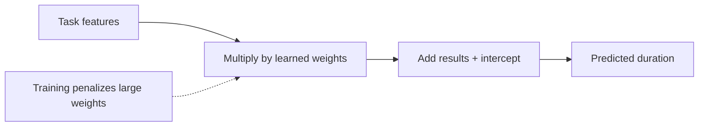
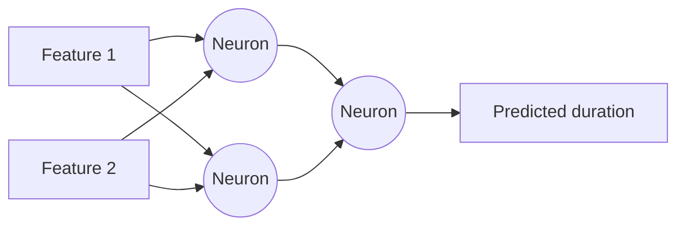
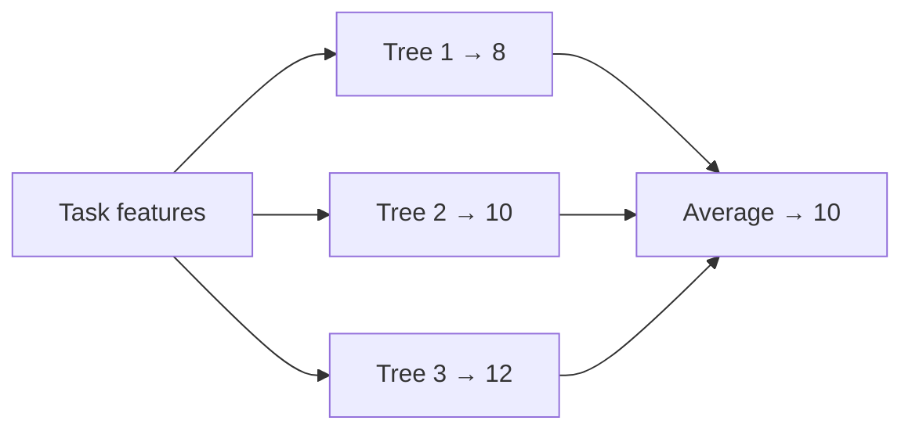
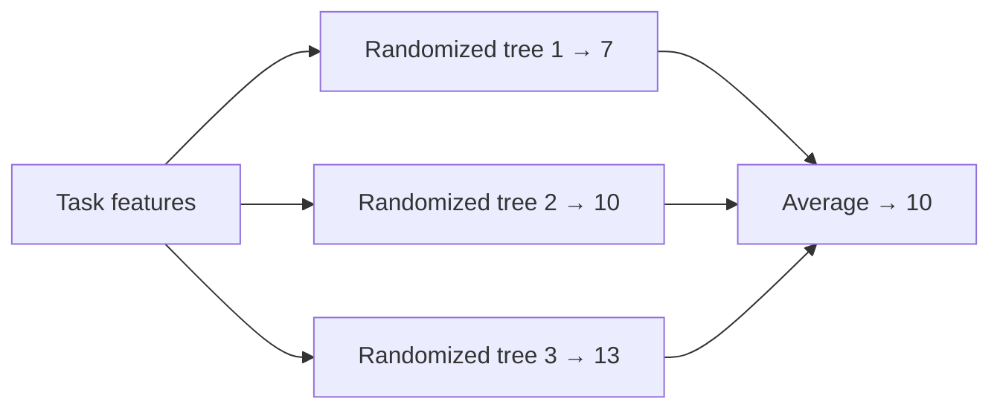

# NGA-OVIS

`NexGen Analytics` work for Sandia `Open-source Varnish Information System`.

## Apps

Entry point for an app is `apps/[name]/src/[name]/cli.py`.

### modeling_training

- `benchmark.py`: Train models and compare results
- `dataset.py`: Loading, feature extraction, targets, splitting
- `evaluation.py`: Metrics and result data structures
- `models.py`: Dummy, Ridge, MLP, Random Forest, etc, model factories

Models:
- **Dummy:** A simple baseline that ignores the input features and always
predicts a fixed value, such as the mean target value. It helps assess whether
more complex models add value.


- **Ridge:** A linear regression model with a penalty that shrinks coefficients,
reducing overfitting and improving stability when features are correlated.



- **MLP:** A multilayer perceptron, or neural network, that learns nonlinear
relationships through layers of interconnected neurons.



- **Random forest:** An ensemble of decision trees trained on different random
samples of the data. Averaging their predictions improves robustness and
reduces overfitting.



- **Extra trees:** An ensemble similar to a random forest, but with more
randomness when choosing tree splits. This often makes training faster and
reduces prediction variance.



- **Hist GB:** Histogram-based gradient boosting builds trees sequentially, with
each tree correcting errors from the previous ones. Grouping feature values into
bins makes training efficient.


### modeling_prediction

Expected CPU and memory for this input deck under the reference configuration.

Reference configuration are:
- `nodes` == 1
- `ntasks` == 48
- `ntasks_per_node` == 48
- `omp_num_threads` == 1

## Setup

```bash
python3 -m venv .venv
source .venv/bin/activate # for Linux and Mac
.\.venv\Scripts\activate # for Windows
(.venv) pip install -r requirements.txt
```

## How to use

```bash
(.venv) modeling-training --simu {path}
# simu (simulations): path to the folder with input decks and run profiles

(.venv) modeling-prediction --model {path} --input {path} --particle-count {count}
# model: path to load model
# input: path to the input deck you want to predict
# particle-count: initial number of simulated particles
```

See the [deck vector schema](doc/deck-vector-schema.md) for
classification rules and cutoff coverage.

## How to quit

```bash
(.venv) deactivate # to exit venv
```

# Examples

```bash
(.venv) modeling-training --simu data/

(.venv) modeling-prediction --model output/models/cpu_model.joblib \
  --input data/input-decks/in.test --particle-count 256000

(.venv) modeling-prediction --model output/models/memory_model.joblib \
  --input data/input-decks/in.test --particle-count 256000
```

# Updates

Oct. 22 2026:
- Usable simulations: 117 -> 164
- Distinct feature vectors: 58 -> 105
- Training simulations: 81 -> 114

# Results

After training (selection summary; per-target error tables are also printed):
```txt
- Total 275 files
- Reference configuration:       nodes=1,       ntasks=48,       ntasks_per_node=48       and omp_num_threads=1
- Load 164 simulations

---------------- RESOURCE: cpu ----------------
MODEL          TARGET               MAE          RMSE  MAE VS DUMMY    RMSE VS DUMMY
dummy          max               0.2389        0.2433          0.0%          0.0%
dummy          mean              2.2388        3.1545          0.0%          0.0%
dummy          min              14.3373       16.0635          0.0%          0.0%
ridge          max               0.4195        0.4881        -75.6%       -100.6%
ridge          mean              2.1588        2.9460          3.6%          6.6%
ridge          min              13.3528       15.2501          6.9%          5.1%
mlp            max               0.2786        1.3378        -16.6%       -449.8%
mlp            mean              1.4397        2.2753         35.7%         27.9%
mlp            min              15.0328       17.0019         -4.9%         -5.8%
random_forest  max               0.1438        0.3583         39.8%        -47.2%
random_forest  mean              1.3765        2.1627         38.5%         31.4%
random_forest  min              13.5002       15.9636          5.8%          0.6%
extra_trees    max               0.0751        0.1359         68.6%         44.1%
extra_trees    mean              1.2595        1.9755         43.7%         37.4%
extra_trees    min              13.2757       15.5999          7.4%          2.9%
hist_gb        max               0.2298        0.6686          3.8%       -174.8%
hist_gb        mean              1.3516        2.3429         39.6%         25.7%
hist_gb        min              13.8952       16.6437          3.1%         -3.6%

Combined validation score (all targets, MAE + RMSE; lower is better):
dummy                  1.0000
ridge                  1.2569
mlp                    1.6893
random_forest          0.8850
extra_trees            0.6598
hist_gb                1.1770
Selected model: extra_trees
Held-out test evaluation: extra_trees (17 simulations)
TARGET               MAE          RMSE
max               0.7717        1.5321
mean              1.3540        1.7482
min               8.6703       11.1452
Saved extra_trees to output/models/cpu_model.joblib

---------------- RESOURCE: memory ----------------
MODEL          TARGET               MAE          RMSE  MAE VS DUMMY    RMSE VS DUMMY
dummy          max           35648.9027    66333.0758          0.0%          0.0%
dummy          mean          33337.2356    67817.6819          0.0%          0.0%
dummy          min           30930.5008    70613.0797          0.0%          0.0%
ridge          max           20878.7660    44421.8451         41.4%         33.0%
ridge          mean          19216.4853    45345.6000         42.4%         33.1%
ridge          min           27304.8738    67065.6122         11.7%          5.0%
mlp            max           22409.6675    43773.7604         37.1%         34.0%
mlp            mean          18916.9481    43762.9887         43.3%         35.5%
mlp            min           27945.5242    68394.7925          9.7%          3.1%
random_forest  max           22974.4532    49209.9948         35.6%         25.8%
random_forest  mean          20743.8295    52975.8733         37.8%         21.9%
random_forest  min           27951.0885    66594.9815          9.6%          5.7%
extra_trees    max           24974.4388    51887.8141         29.9%         21.8%
extra_trees    mean          23379.9860    55420.0235         29.9%         18.3%
extra_trees    min           27618.5837    67134.7369         10.7%          4.9%
hist_gb        max           23902.1706    48863.1720         33.0%         26.3%
hist_gb        mean          19001.6799    49053.1097         43.0%         27.7%
hist_gb        min           29731.7952    66678.8200          3.9%          5.6%

Combined validation score (all targets, MAE + RMSE; lower is better):
dummy                  1.0000
ridge                  0.7222
mlp                    0.7289
random_forest          0.7727
extra_trees            0.8075
hist_gb                0.7677
Selected model: ridge
Held-out test evaluation: ridge (17 simulations)
TARGET               MAE          RMSE
max           17915.1845    26709.6032
mean          11555.7302    18501.4972
min           12369.2333    15238.0424
Saved ridge to output/models/memory_model.joblib
```
