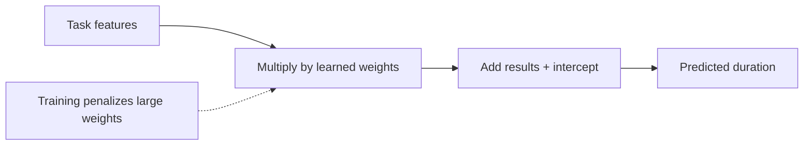
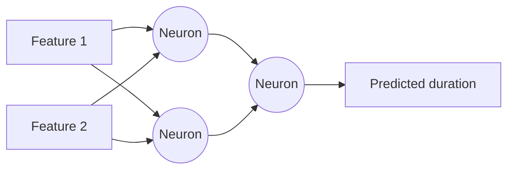
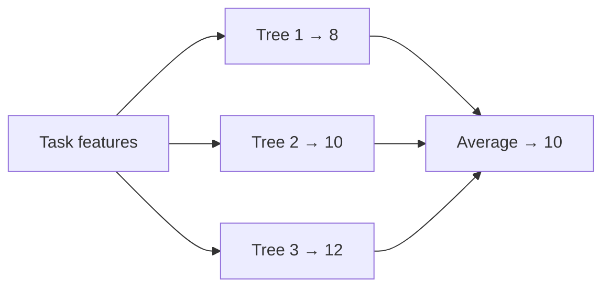
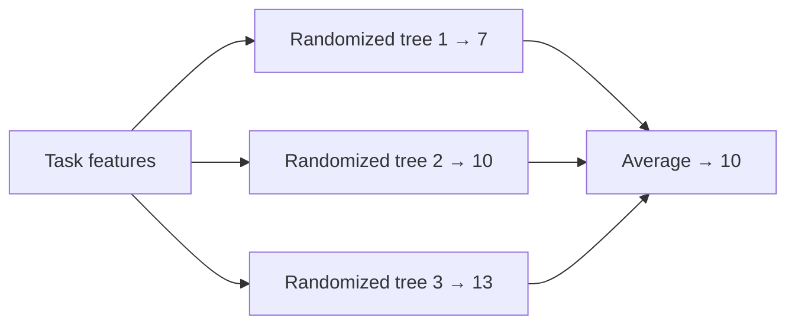
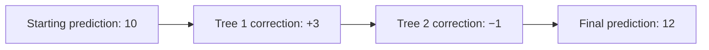

# `predicter/models.py`

- **Dummy:** A simple baseline that ignores the input features and always
predicts a fixed value, such as the mean target value. It helps assess whether
more complex models add value.


- **Ridge:** A linear regression model with a penalty that shrinks coefficients,
reducing overfitting and improving stability when features are correlated.



- **MLP:** A multilayer perceptron, or neural network, that learns nonlinear
relationships through layers of interconnected neurons.



- **Random forest:** An ensemble of decision trees trained on different random
samples of the data. Averaging their predictions improves robustness and
reduces overfitting.



- **Extra trees:** An ensemble similar to a random forest, but with more
randomness when choosing tree splits. This often makes training faster and
reduces prediction variance.



- **Hist GB:** Histogram-based gradient boosting builds trees sequentially, with
each tree correcting errors from the previous ones. Grouping feature values into
bins makes training efficient.



# Architecture

```
*cli.py*
-> load_datas
---> parse_inputdeck / *parsing.py*
---> filter_metric / *visualizer.metrics*
---> max_value / *visualizer.metrics*
-> split_set
-> prepare_dataset / *prepare.py*
---> define_deck / *decker.py*
-> run_benchmark / *benchmark.py*
---> evaluate_predictions / *evaluation.py*

```
